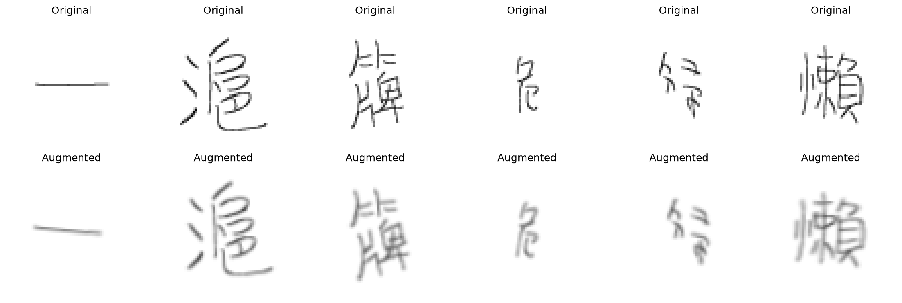
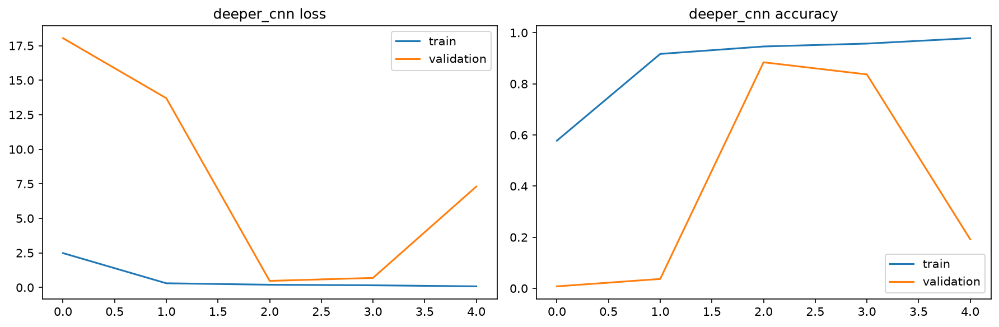
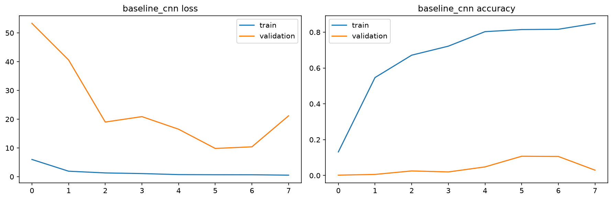
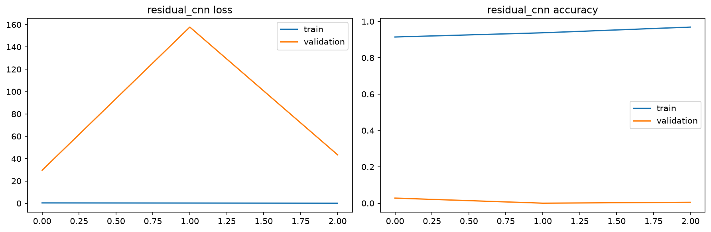
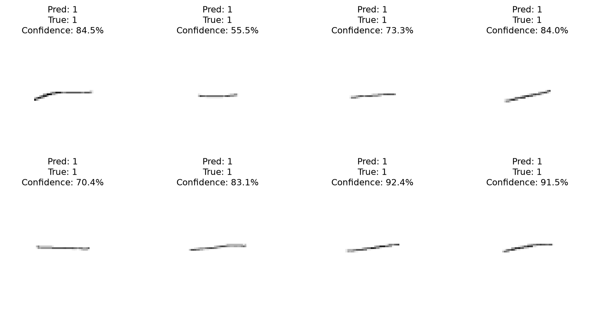

# Traditional Chinese Handwriting Recognition

A DIT5411 Machine Learning assignment that uses **Python and TensorFlow** to recognize handwritten Traditional Chinese characters. The project compares three convolutional neural network architectures and reports their recognition accuracy on an untouched testing set.

**Best result: Deeper CNN — 85.83% testing accuracy across 13,065 character classes.**

## 1. Project Overview

The objectives of this project are to:

- Build a multi-class handwriting recognizer using TensorFlow.
- Use data augmentation to increase the effective number of training samples to at least 200 per character.
- Compare three CNN architectures with 13,065 output neurons and a softmax activation.
- Evaluate each model using the same testing images and select the model with the highest recognition accuracy.

The complete workflow is available in [DIT5411_Colab.ipynb](DIT5411_Colab.ipynb). It includes dataset downloading and verification, preprocessing, augmentation, model training, checkpoint recovery, evaluation, and sample predictions.

### Dataset

This project uses the **Traditional Chinese Handwriting Dataset**, originally produced based on **Tegaki**, an open-source handwriting package.

- **13,065** Traditional Chinese character classes
- **684,677** images in total
- Approximately **50 samples per character**
- Original image size: **300 × 300 pixels**
- Preprocessed model input: **64 × 64 grayscale images**

Dataset links:

- [Dataset description and license](https://github.com/AI-FREE-Team/Traditional-Chinese-Handwriting-Dataset)
- [Complete dataset download used by this project](https://github.com/chenkenanalytic/handwritting_data_all)

The dataset is licensed under **CC BY-NC-SA 4.0**. Please retain the original attribution when using or sharing it.

### Training, Validation, and Testing Split

For each character with at least 40 images:

1. The first 40 images, ordered by their numeric sample suffix, form the original training portion.
2. The remaining images form the testing set and are never augmented.
3. Ten percent of the original training portion is held out for validation. A typical class therefore uses 36 original images for model fitting and 4 for validation.

There are **43 classes with fewer than 40 images**. For these classes, approximately 80% of the available images are used for the original training portion instead, while retaining at least one testing image per class.

| Subset | Number of original images |
|---|---:|
| Model-fitting images | 469,684 |
| Validation images | 52,196 |
| Testing images | 162,797 |
| **Total** | **684,677** |

The detailed counts are recorded in [dataset_summary.json](dataset_summary.json), and the output-label mapping is stored in [class_mapping.json](class_mapping.json).

## 2. Environment and Installation

### Software

- Python 3.11+ (Python 3.11 and 3.13 were used during development)
- TensorFlow 2.20.0
- OpenCV 5.0.0
- NumPy for array and index processing
- Matplotlib for plots
- scikit-learn for supporting analysis
- Jupyter / nbconvert for notebook execution
- TensorFlow Metal for Apple Silicon, when available

All Python dependencies are listed in [requirements.txt](requirements.txt).

### Installation

Create and activate a virtual environment:

```bash
python -m venv .venv
```

Windows:

```bash
.venv/Scripts/python.exe -m pip install --upgrade pip
.venv/Scripts/python.exe -m pip install -r requirements.txt
```

macOS / Linux:

```bash
source .venv/bin/activate
python -m pip install --upgrade pip
python -m pip install -r requirements.txt
```

On Apple Silicon, the requirements file installs `tensorflow-metal` only when the platform is `darwin` with an ARM64 processor. The notebook also checks for the Metal plug-in automatically.

### Training Environment

The reported result files were produced by a **local macOS run**. The notebook supports the following execution modes:

| Platform | Compute backend |
|---|---|
| Local Windows | CPU with the standard TensorFlow package |
| Local macOS with Apple Silicon | Metal GPU when detected; otherwise CPU |
| Windows with NVIDIA GPU | TensorFlow CUDA through WSL2 / Ubuntu |
| Google Colab | GPU when selected and available |

Mixed precision is enabled only when TensorFlow detects a compatible GPU. Otherwise, training uses float32 on the CPU. The notebook automatically prints the detected platform and visible GPU devices at startup.

## 3. Data Augmentation

The small number of original samples per character is a major challenge. Augmentation is therefore performed **on the fly during training**, without saving millions of additional image files.

OpenCV is used to decode and resize the original images. The augmentation itself uses TensorFlow/Keras preprocessing layers:

| Transformation | Setting | Purpose |
|---|---|---|
| Rotation | Random rotation up to approximately ±10.8° | Simulate different writing angles |
| Scaling / zoom | Random zoom within approximately ±10% | Simulate different character sizes |
| Shearing | Random horizontal shear from 0 to 12% of image width | Simulate slanted handwriting |
| Translation | Random horizontal and vertical shift up to 3% | Simulate different character positions |

Empty regions are filled with white to match the image background.

For each class, original fitting images are repeated with new random transformations until at least **200 augmented fitting samples per class per epoch** are available. A typical class has 36 fitting images, which are repeated six times to produce 216 augmented samples. Only the model-fitting subset is augmented; validation and testing images remain unchanged.

The complete training plan contains **2,821,721 augmented fitting samples per epoch**, with at least 200 samples for every class.

### Before and After Augmentation



## 4. Model Architectures

All models accept a `64 × 64 × 1` grayscale input and end with a **13,065-neuron softmax output layer**. Batch Normalization is used after convolutional layers, and the classification head contains global average pooling, a 256-unit dense layer, and 0.4 dropout.

| Model | Architecture | Design rationale |
|---|---|---|
| **Model A: Baseline CNN** | Three convolutional blocks with 32, 64, and 128 filters; one 3 × 3 convolution and one 2 × 2 max-pooling layer per block | A lightweight reference model for evaluating whether a simple CNN is sufficient |
| **Model B: Deeper CNN** | Four blocks with 32, 64, 128, and 256 filters; two 3 × 3 convolutions per block, followed by max pooling | Additional convolutional layers learn more detailed stroke and structural features |
| **Model C: Residual CNN** | A 32-filter stem followed by four residual blocks with 32, 64, 128, and 256 filters; stride-2 downsampling and projection shortcuts | Residual connections test whether a deeper network with improved gradient flow can outperform standard CNNs |

The shared classification head is:

```text
Global Average Pooling
→ Dense (256 units, ReLU)
→ Dropout (0.4)
→ Dense (13,065 units, softmax)
```

Global average pooling reduces the number of parameters before the large output layer. Dropout is used to reduce overfitting caused by the limited number of original images per class.

## 5. Training Configuration

| Setting | Value |
|---|---|
| Optimizer | Adam |
| Initial learning rate | 0.001 |
| Loss function | Sparse categorical cross-entropy |
| Evaluation metric | Accuracy |
| Local batch size | 64 |
| Colab batch size | 256 |
| Maximum epochs | 10 per model |
| Early stopping | Monitor validation accuracy; patience of 2 epochs; restore best weights |
| Learning-rate schedule | Reduce by 0.5 when validation loss does not improve for 1 epoch |
| Minimum learning rate | 0.00001 |
| Checkpointing | Save best and latest model after each epoch |

Sparse categorical cross-entropy is the integer-label form of categorical cross-entropy and avoids creating a large one-hot vector for every sample.

The best model can be restored after interruption. Completed models are skipped when the notebook is rerun, while incomplete models resume from their latest checkpoint.

## 6. Results and Accuracy Comparison

All three models were evaluated on the same **162,797 untouched testing images**.

| Rank | Model | Testing accuracy | Testing loss |
|---:|---|---:|---:|
| **1** | **Deeper CNN (Best)** | **85.83%** | **0.6060** |
| 2 | Baseline CNN | 10.71% | 10.0873 |
| 3 | Residual CNN | 2.95% | 29.6729 |

The machine-readable results are available in [model_results.csv](model_results.csv) and [model_results.json](model_results.json).

### Deeper CNN Training Curve

The best validation accuracy was **88.42%**, reached at epoch 2. Later epochs showed overfitting, so early stopping and best-weight restoration were important.



### Baseline and Residual CNN Training Curves

| Baseline CNN | Residual CNN |
|---|---|
|  |  |

The Baseline and Residual models achieved high training accuracy but much lower validation and testing accuracy, indicating substantial overfitting. The Deeper CNN generalized much better and was therefore selected as the final model.

### Sample Predictions

The following image shows predictions from the selected model on a testing batch. Labels are the dataset class IDs stored in `class_mapping.json`.



### Reproducibility Files

- [Baseline training log](baseline_cnn_training.csv)
- [Deeper CNN training log](deeper_cnn_training.csv)
- [Residual CNN training log](residual_cnn_training.csv)
- [Best Deeper CNN model](models/deeper_cnn_final.keras)

## 7. Demo and Usage

### Run the Complete Notebook

After installing the dependencies, run the following command from the project directory:

```bash
python -m nbconvert --to notebook --execute DIT5411_Colab.ipynb --ExecutePreprocessor.timeout=-1 --output outputs/DIT5411_local_executed.ipynb
```

The notebook automatically downloads the dataset to `data/all_data.zip` if it is not present. Local models, logs, plots, and results are saved to:

```text
outputs/DIT5411_local/
```

To use Google Colab instead, upload `DIT5411_Colab.ipynb`, select a GPU runtime, and choose **Run all**. Colab outputs are saved to Google Drive.

For a short pipeline check, set `SMOKE_TEST = True` in the first code cell. Smoke-test results are not valid assignment results; full experiments must use `SMOKE_TEST = False`.

### Predict One Handwritten Image

The following example loads the best model and predicts the dataset class ID of a new image. Save the input as `handwriting.png`, or change the path in the code.

```python
import json

import cv2
import numpy as np
import tensorflow as tf

model = tf.keras.models.load_model("models/deeper_cnn_final.keras")

with open("class_mapping.json", encoding="utf-8") as file:
    class_mapping = json.load(file)

image = cv2.imread("handwriting.png", cv2.IMREAD_GRAYSCALE)
assert image is not None, "Cannot read handwriting.png"

image = cv2.resize(image, (64, 64), interpolation=cv2.INTER_AREA)
image = image.astype(np.float32) / 255.0
image = image.reshape(1, 64, 64, 1)

probabilities = model.predict(image, verbose=0)[0]
top_three = np.argsort(probabilities)[-3:][::-1]

for label in top_three:
    class_id = class_mapping[str(int(label))]
    confidence = float(probabilities[label])
    print(f"Class ID: {class_id}, confidence: {confidence:.2%}")
```

For consistent results, use a single handwritten character on a clean background, similar to the dataset images.

## 8. Conclusion

The **Deeper CNN achieved the best testing accuracy of 85.83%**, significantly outperforming the Baseline and Residual models. Its repeated convolutional layers were better able to learn the detailed strokes and structures of Traditional Chinese characters without the severe generalization failure observed in the other two models.

The main challenges and solutions were:

- **Large number of classes:** A 13,065-neuron softmax output and integer labels were used with sparse categorical cross-entropy.
- **Limited original samples:** On-the-fly rotation, scaling, shearing, and translation increased each class to at least 200 fitting samples per epoch.
- **Storage constraints:** Augmented images were generated dynamically rather than saved as millions of separate files.
- **Long training sessions and disconnections:** Best/latest checkpoints, training logs, and resume support were added.
- **Different hardware platforms:** The notebook detects Colab, local CPU, NVIDIA WSL2, and Apple Silicon Metal environments.
- **Overfitting:** Validation monitoring, dropout, learning-rate reduction, early stopping, and best-weight restoration were used.

Future improvements could include stronger regularization, wider hyperparameter searches, and more diverse model architectures. A full confusion matrix is not shown because 13,065 classes make it impractical to read; per-class precision, recall, and top-k accuracy would be more informative additional evaluations.

## 9. References

1. [AI-FREE-Team — Traditional Chinese Handwriting Dataset](https://github.com/AI-FREE-Team/Traditional-Chinese-Handwriting-Dataset)
2. [chenkenanalytic — Complete Handwriting Dataset Download](https://github.com/chenkenanalytic/handwritting_data_all)
3. [darshitajain — Introduction to OpenCV](https://github.com/darshitajain/Introduction-to-OpenCV)
4. [kimanalytics — Handwritten Digit Recognition using Keras and TensorFlow](https://github.com/kimanalytics/Handwritten-Digit-Recognition-using-Keras-and-TensorFlow)
5. [TensorFlow Keras Documentation](https://www.tensorflow.org/guide/keras)
6. [Apple — TensorFlow Metal Plug-in](https://developer.apple.com/metal/tensorflow-plugin/)
